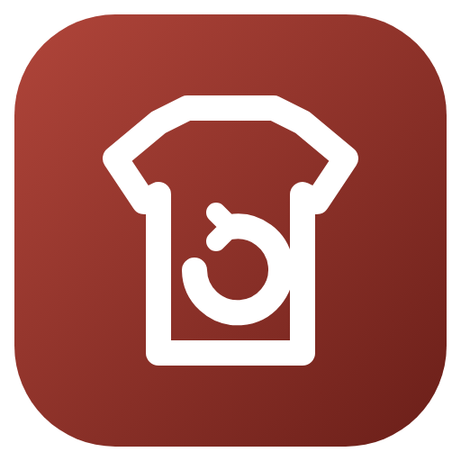

<p align="center"></p>

<h1 align="center">CoreProtect Item Restore</h1>

<p align="center">Command-line tool that turns CoreProtect container records back into exact Minecraft 1.21 items: armor stand equipment or /give commands, with enchantments, durability and mod data.</p>

<p align="center">
  <a href="https://github.com/milkycloud-dev/coreprotect-item-restore/actions/workflows/release.yml"></a>
  <a href="https://github.com/milkycloud-dev/coreprotect-item-restore/releases/latest"></a>
  <a href="LICENSE"></a>
</p>

<p align="center"><a href="#english">English</a> | <a href="#русский">Русский</a></p>

<a id="english"></a>

## English

### Overview

CoreProtect logs every item a player takes from a container, including armor stands, in `co_container`. Each row keeps the full item meta as a Java-serialized blob. A rollback normally puts the items back, but not always: when a griefer breaks an armor stand and places an empty one in its spot, the rollback brings the stand back without its equipment, and the logged items are not restored anywhere.

This tool reads those rows and rebuilds the items:

1. `decode` turns a tab-separated export of `co_container` rows into JSON. It unpacks the Java serialization, and the gzipped NBT inside it that holds custom data and unhandled mod components, keeping every number's NBT type.
2. `commands` turns that JSON into console commands:
   - `stand` mode (default): one `execute ... run item replace entity` per item, aimed at the nearest armor stand within 1.2 blocks of the logged position. By default it only fills empty slots, so nothing a player has put back is overwritten.
   - `give` mode: `/give <player> <item> <count>` per row, for containers or for handing items over directly.

Items keep their damage, enchantments, repair cost, custom data, attribute modifiers and unhandled mod components (for example Twilight Forest traveller stats).

### Requirements

- Python 3.10 or newer and `javaobj-py3` (`pip install -r requirements.txt`), or the packaged release build
- Read access to the CoreProtect MySQL/MariaDB database
- A Minecraft 1.21.x server for the commands (item component syntax)

### Usage

Export the rows you need. Example: everything one player took from armor stands and chests in a box around a base.

```sql
SELECT c.rowid, CONCAT(c.x,' ',c.y,' ',c.z), m.material, c.amount, HEX(c.metadata)
FROM co_container c
JOIN co_material_map m ON m.rowid = c.type
JOIN co_user u ON u.rowid = c.user
WHERE u.user = 'Griefer' AND c.action = 0 AND c.wid = 1
  AND c.x BETWEEN 100 AND 220 AND c.z BETWEEN -290 AND -110
ORDER BY c.rowid;
```

Save it as tab-separated text without a header (`mysql -N ... > rows.tsv`), then:

```
cp_restore decode rows.tsv items.json
cp_restore commands items.json --namespaces twilightforest,aether,betterend --out commands.txt
cp_restore commands items.json --mode give --player Owner --namespaces twilightforest,aether
```

Bukkit names modded items `minecraft:<modid>_<item>`. `--namespaces` lists the mod ids to split back into `<modid>:<item>`. Other options: `--world` (dimension, default overworld), `--radius` (how far the stand may be), `--overwrite` (replace filled slots).

Run the commands from the server console. In stand mode the chunks must be loaded: stand nearby, or wrap the run in `forceload add` and `forceload remove`.

### Testing

Unit tests in `tests/` cover NBT types, JSON round trips, stand and give commands, modded namespaces and attribute modifiers (`python -m unittest discover -s tests`). The tool was also checked against 28 real rows from a live server: all decoded, and the commands match hand-built ones that restored the equipment of six armor stands, apart from two values where the tool now keeps the stored double/float type exactly.

### Releases

Every tag `v*` is built by GitHub Actions for Windows and Linux and published in [Releases](../../releases). The build log of each release is public.

### Known limitations

- Only rows with `action = 0` (items taken) make sense as a restore source. Rows with an empty meta come out as plain items.
- Item meta that CoreProtect itself did not store (for example some block entity contents of shulker boxes on hybrid cores) cannot be recovered.
- Commands use 1.21 item component syntax and do not work on 1.20.4 or older.

### License

Proprietary, all rights reserved. Official release binaries may be run unmodified on servers you operate. Copying, modifying or redistributing the code or the binaries requires written permission. Full terms: [LICENSE](LICENSE).

<a id="русский"></a>

## Русский

### Обзор

CoreProtect записывает в `co_container` каждый предмет, который игрок забирает из контейнера, включая стойки для брони. В каждой строке хранится полное описание предмета в виде сериализованного Java-объекта. Откат обычно возвращает предметы, но не всегда: если грифер ломает стойку и ставит на её место пустую, откат возвращает стойку без экипировки, а записанные предметы никуда не возвращаются.

Утилита читает эти строки и собирает предметы заново:

1. `decode` превращает выгрузку строк `co_container` через табуляцию в JSON. Она разбирает Java-сериализацию и сжатый gzip NBT внутри неё, где лежат пользовательские данные и необработанные компоненты модов, и сохраняет NBT-тип каждого числа.
2. `commands` превращает этот JSON в консольные команды:
   - режим `stand` (по умолчанию): по одной команде `execute ... run item replace entity` на предмет, нацеленной на ближайшую стойку в пределах 1,2 блока от записанной позиции. По умолчанию заполняются только пустые слоты, так что вещи, которые игрок уже вернул сам, не затираются.
   - режим `give`: `/give <игрок> <предмет> <количество>` на строку, для сундуков или чтобы просто выдать вещи.

У предметов сохраняются прочность, зачарования, стоимость починки, пользовательские данные, модификаторы атрибутов и необработанные компоненты модов (например, характеристики снаряжения путешественника из Twilight Forest).

### Требования

- Python 3.10 и новее и `javaobj-py3` (`pip install -r requirements.txt`) или готовая сборка из релизов
- Доступ на чтение к базе CoreProtect в MySQL/MariaDB
- Сервер Minecraft 1.21.x для команд (синтаксис компонентов предметов)

### Использование

Выгрузить нужные строки. Пример: всё, что один игрок забрал со стоек и из сундуков в квадрате вокруг базы.

```sql
SELECT c.rowid, CONCAT(c.x,' ',c.y,' ',c.z), m.material, c.amount, HEX(c.metadata)
FROM co_container c
JOIN co_material_map m ON m.rowid = c.type
JOIN co_user u ON u.rowid = c.user
WHERE u.user = 'Griefer' AND c.action = 0 AND c.wid = 1
  AND c.x BETWEEN 100 AND 220 AND c.z BETWEEN -290 AND -110
ORDER BY c.rowid;
```

Сохранить как текст через табуляцию без заголовка (`mysql -N ... > rows.tsv`), затем:

```
cp_restore decode rows.tsv items.json
cp_restore commands items.json --namespaces twilightforest,aether,betterend --out commands.txt
cp_restore commands items.json --mode give --player Owner --namespaces twilightforest,aether
```

Bukkit называет предметы модов `minecraft:<modid>_<item>`. `--namespaces` перечисляет id модов, которые нужно отделить обратно в `<modid>:<item>`. Другие параметры: `--world` (измерение, по умолчанию верхний мир), `--radius` (насколько далеко может стоять стойка), `--overwrite` (заменять занятые слоты).

Команды выполнять из консоли сервера. В режиме стоек чанки должны быть загружены: стоять рядом или обернуть запуск в `forceload add` и `forceload remove`.

### Проверка

Модульные тесты в `tests/` покрывают NBT-типы, перевод в JSON и обратно, команды для стоек и выдачи, пространства имён модов и модификаторы атрибутов (`python -m unittest discover -s tests`). Утилита также проверена на 28 настоящих строках с живого сервера: все разобраны, а команды совпадают с собранными вручную, которыми вернули экипировку шести стоек, кроме двух значений, где утилита теперь точно сохраняет записанный тип double/float.

### Релизы

Каждый тег `v*` собирается в GitHub Actions для Windows и Linux и публикуется в [Releases](../../releases). Лог сборки каждого релиза открыт.

### Ограничения

- Источником для восстановления имеют смысл только строки с `action = 0` (предмет забран). Строки с пустым описанием дают обычные предметы.
- То, чего CoreProtect сам не сохранил (например, часть содержимого шалкеров на гибридных ядрах), восстановить нельзя.
- Команды используют синтаксис компонентов 1.21 и не работают на 1.20.4 и старше.

### Лицензия

Проприетарная, все права защищены. Официальные сборки из релизов можно запускать без изменений на своих серверах. Копировать, изменять и распространять код или сборки можно только с письменного разрешения. Полный текст: [LICENSE](LICENSE).
